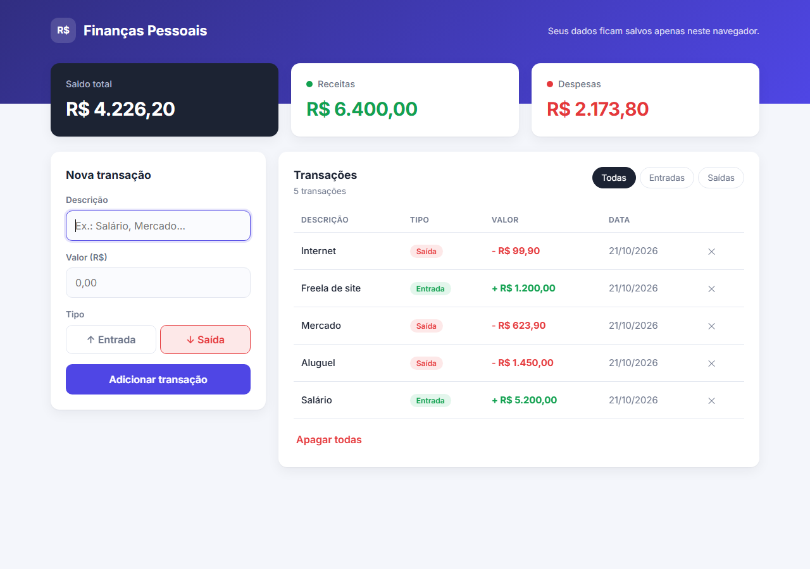

# Dashboard de Finanças Pessoais

Gerenciador de entradas e saídas de dinheiro com **saldo atualizado automaticamente** e **persistência no `localStorage`**. Se você der F5, os dados continuam lá. Inspirado na interface web do Mobills e do Splitwise.

**[▶ Ver demo online](https://henrysenaaa.github.io/dashboard-financas/)**



## Funcionalidades

- **Painel superior** com três cards: Saldo Total, Receitas e Despesas, atualizados a cada alteração. O card de saldo fica vermelho quando o saldo está negativo.
- **Formulário** com Descrição, Valor e Tipo (Entrada/Saída), com validação e mensagens de erro amigáveis.
- Aceita valores no **formato brasileiro**: `1.450`, `1.234,56`, `R$ 99,90`.
- **Tabela de transações**: receitas em **verde**, despesas em **vermelho**, mais recentes primeiro.
- **Filtros** (Todas / Entradas / Saídas), remoção individual e "Apagar todas".
- **Persistência** no `localStorage`, com sincronização entre abas abertas (evento `storage`).
- Cálculos feitos **em centavos**, para evitar erros de ponto flutuante (`0.1 + 0.2`).

## Tecnologias e conceitos

- HTML5, CSS3 e **JavaScript puro**
- Gerenciamento de estado: um único array `transactions` é a fonte da verdade e toda a interface é renderizada a partir dele
- `localStorage` com tratamento de dados corrompidos
- `Intl.NumberFormat` para formatar a moeda em BRL
- Dados do usuário inseridos via `textContent` (proteção contra XSS)

## Estrutura

```
├── index.html
├── style.css
├── js/
│   ├── logic.js   # regras de negócio puras: validação, cálculos, storage
│   └── app.js     # interface: formulário, tabela, cards
└── tests/         # testes automatizados (node:test + jsdom)
```

## Como rodar

Basta abrir o `index.html` no navegador.

## Testes

```bash
npm install
npm test
```

São 18 testes cobrindo cálculos, validação, formatação, persistência após recarregar a página, filtros, remoção e proteção contra XSS.

## Licença

MIT
